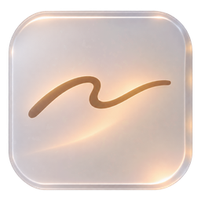
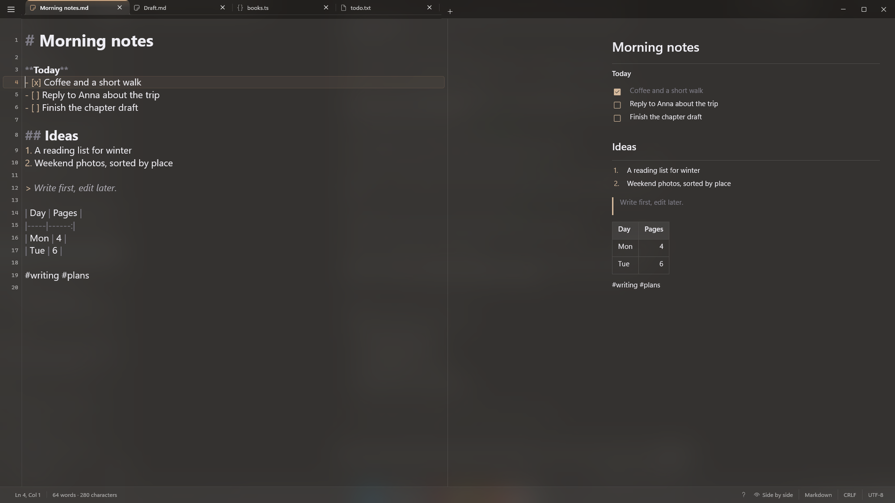
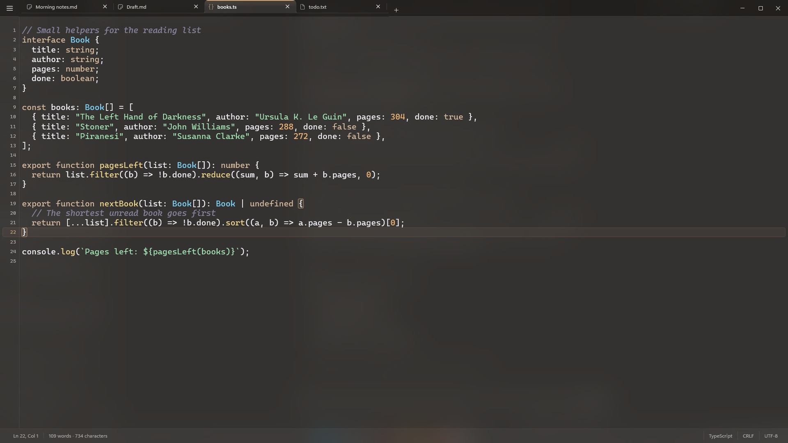
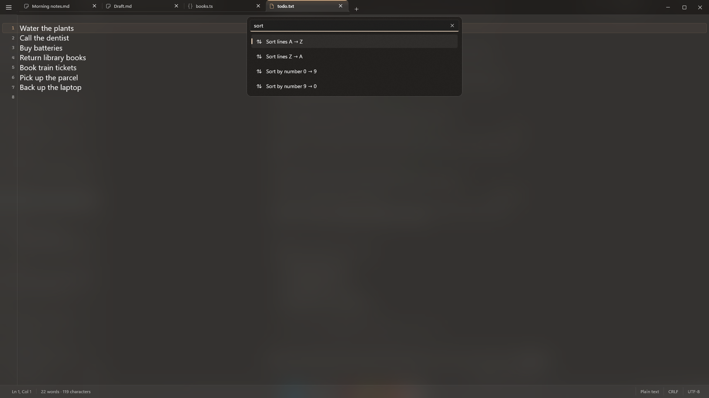
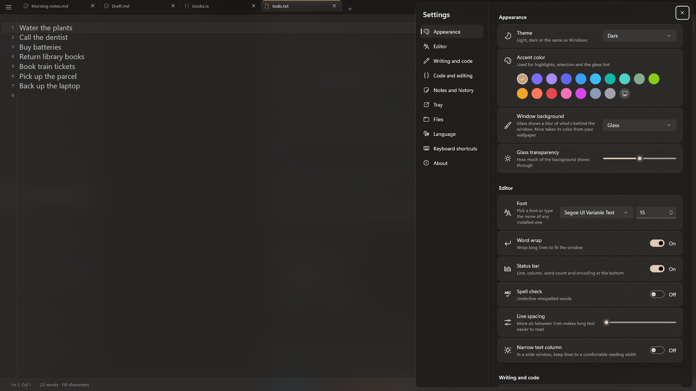
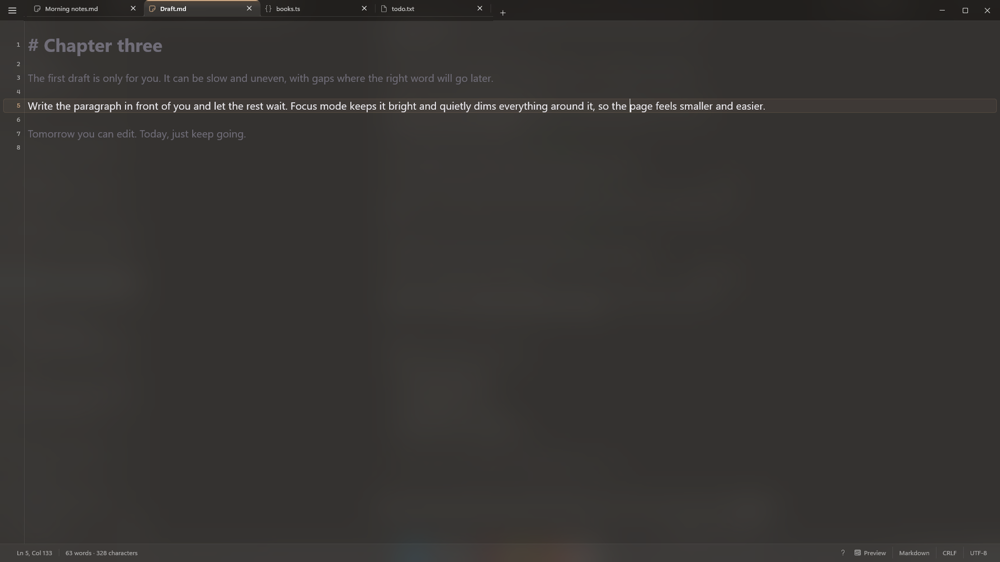

<p align="center">
  
</p>

<h1 align="center">Vellum Notes</h1>

<p align="center">
  A glass notepad for Windows: notes, Markdown and text files in one calm window.
</p>

<p align="center">
  <a href="https://apps.microsoft.com/detail/9PPMCLGKLBPM"><b>Get it from Microsoft Store</b></a>
  ·
  <a href="https://vellum.wesky.space">Website</a>
  ·
  <a href="https://vellum.wesky.space/privacy/">Privacy</a>
</p>

<p align="center">
  
</p>

Vellum is a free notepad for Windows 11 and 10 that looks at home on the system: a soft glass window (Acrylic or Mica), a warm accent color and nothing extra on the screen. Everything else opens with a shortcut or from the command palette, and every feature can be switched off.

It works fully offline. No account, no ads, no analytics, no tracking.

## Features

**Writing**
- Focus mode dims everything but the current paragraph
- Typewriter mode keeps the line you type in the middle
- Word goal, word and character counter
- Markdown with live preview and a cheat sheet
- Lists continue by themselves on Enter
- Quick note from the tray or <kbd>Ctrl</kbd>+<kbd>Alt</kbd>+<kbd>N</kbd>, from any app
- Mini window that stays on top

**Code**
- Syntax highlighting and line numbers
- Current line, matching brackets, <kbd>Ctrl</kbd>+<kbd>B</kbd> to jump
- Brackets and quotes close themselves
- Comment a line with <kbd>Ctrl</kbd>+<kbd>/</kbd>
- Bookmarks on the margin

**Text tools**
- Duplicate, move, sort and shuffle lines
- Remove duplicates, empty lines, extra spaces
- UPPER, lower, Title Case and more
- Format or minify JSON, MD5 / SHA hashes
- Base64 and URL encode / decode

**Files and notes**
- Tabs with autosave and session restore
- UTF-8, UTF-16, Windows-1251, KOI8-R, CP866 and more
- Notes library with #tags, search and pins
- Version history with changes highlighted
- Notices when a file changes in another app
- Export to PDF and HTML
- Notes under a password (AES-256, encrypted on your device)

**Look**
- Acrylic, Mica or solid background, adjustable glass strength
- Light and dark themes, 17 accent colors
- 12 interface languages

## Screenshots

| | |
|---|---|
|  |  |
|  |  |

## Shortcuts worth remembering

| Keys | Action |
|---|---|
| <kbd>Ctrl</kbd>+<kbd>Shift</kbd>+<kbd>P</kbd> | Command palette |
| <kbd>Ctrl</kbd>+<kbd>F</kbd> | Find and replace |
| <kbd>Ctrl</kbd>+<kbd>Shift</kbd>+<kbd>L</kbd> | Notes library |
| <kbd>Ctrl</kbd>+<kbd>Shift</kbd>+<kbd>H</kbd> | Version history |
| <kbd>Ctrl</kbd>+<kbd>,</kbd> | Settings |
| <kbd>Ctrl</kbd>+<kbd>Shift</kbd>+<kbd>T</kbd> | Reopen closed tab |
| <kbd>Ctrl</kbd>+<kbd>D</kbd> | Duplicate line |
| <kbd>Alt</kbd>+<kbd>↑</kbd> / <kbd>↓</kbd> | Move line |

## Building from source

Requirements:
- Windows 10 version 2004 (build 19041) or later
- [Visual Studio 2022 or newer](https://visualstudio.microsoft.com/) with the **WinUI application development** workload
- .NET 10 SDK

Steps:
1. Clone the repository.
2. Open `Vellum.slnx` in Visual Studio.
3. Pick the `x64` platform and the **Vellum (Package)** profile, then press <kbd>F5</kbd>.

The app is built with [WinUI 3](https://learn.microsoft.com/windows/apps/winui/winui3/) and the Windows App SDK, packaged as MSIX. Markdown is parsed with [Markdig](https://github.com/xoofx/markdig).

### Project layout

```
src/Vellum/            the app
  Controls/            editor, settings, palette and other views
  Services/            files, notes, history, export, syntax highlighting
  Strings/<lang>/      interface texts (Resources.resw)
tools/
  i18n/<lang>.tsv      translations, one key and text per line
  build_resw.py        builds Strings/<lang>/Resources.resw from the .tsv files
  make_icons.py        generates every app icon size from assets/icon.png
```

## Translations

Vellum speaks English, Ukrainian, Russian, German, Spanish, French, Portuguese (Brazil), Italian, Polish, Turkish, Simplified Chinese and Japanese.

To fix or add a translation, edit `tools/i18n/<lang>.tsv` (English lives in `src/Vellum/Strings/en-US/Resources.resw`), then run:

```
python tools/build_resw.py
```

## Feedback

Found a bug or have an idea? [Open an issue](../../issues) or write to hello@wesky.space. Pull requests are welcome; for bigger changes, please open an issue first so we can talk it through.

## License

The source code is licensed under the [GNU General Public License v3.0](LICENSE). You may use, study, change and share it; anything you distribute that is based on it must stay open under the same license.

The name **Vellum**, the Vellum icon and the Wesky name and logo are not covered by the license. If you publish your own build, please give it a different name and icon so people don't confuse it with the official app.

Made by [Wesky](https://wesky.space), a small independent studio.
